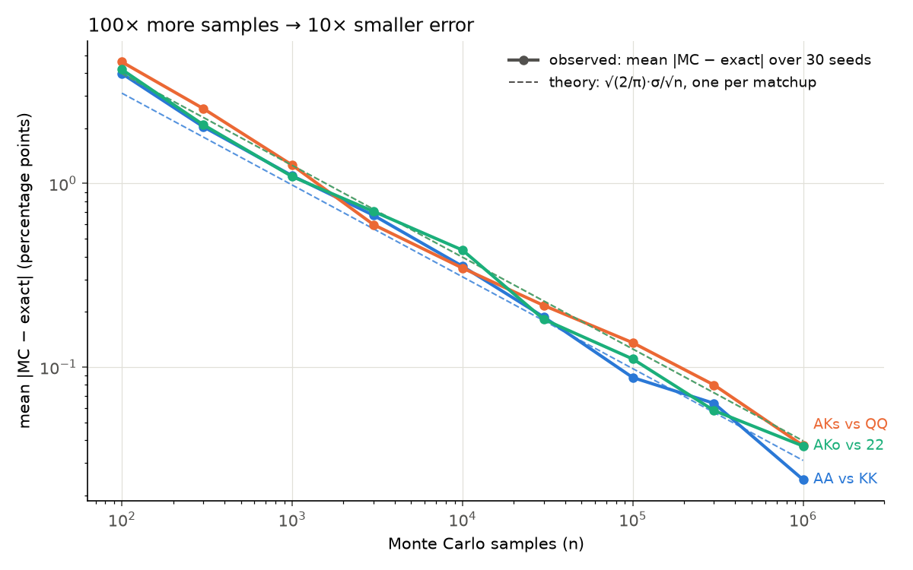
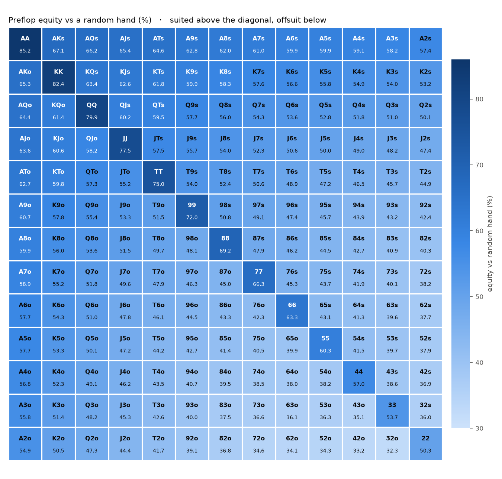

# holdem-equity

*Built with an AI coding agent. I chose the project, checked every number and can explain all of the code (see [WALKTHROUGH.md](WALKTHROUGH.md)).*

Exact vs Monte Carlo poker equity: every one of the 1.7M possible boards is enumerated, and Monte Carlo estimates are measured against that exact answer to show the error falls like 1/√n. It's the same check you'd run on a Monte Carlo pricer or VaR model. It also builds a 169×169 preflop equity table and analyses it with pandas.

## Results

**Equity** is a hand's expected share of the pot when both players are all-in: P(win) + ½·P(tie).

**Preflop all-in equity.** The exact values enumerate all 1,712,304 boards (~3 s each). Each class average is exact too, averaged over every suit combination of the two hands.

| Matchup | Exact | Monte Carlo, 100k samples (seed 1) | Error | Class average (exact) |
|---|---|---|---|---|
| A♥A♠ vs K♦K♣ | **81.26%** | 81.33% ± 0.12 | +0.08 pp = +0.6 SE | AA vs KK **81.95%** |
| A♥K♥ vs Q♠Q♦ | **46.21%** | 45.88% ± 0.16 | −0.33 pp = −2.1 SE | AKs vs QQ **46.05%** |
| A♥K♦ vs 2♠2♣ | **46.96%** | 46.68% ± 0.16 | −0.28 pp = −1.8 SE | AKo vs 22 **47.35%** |

Suits matter, so a specific matchup can differ from its class average by several tenths of a point.

**Monte Carlo accuracy, in standard errors.** At 100k samples the SE is ≈ 0.16 pp, so a 95% interval is ±0.31 pp. The observed errors above are 0.6–2.1 SE: one of the three falls just outside 1.96 SE, which happens to about 1 run in 20. A single seed proves little, so the plot below averages 30 seeds per point.

The exact engine is fast because hand evaluation is vectorised with numpy. It is 8× faster than calling `treys` one hand at a time and gives identical ranks; [scripts/benchmark.py](scripts/benchmark.py) reproduces this.

**Monte Carlo error falls like 1/√n.** Each point is the mean |MC − exact| over 30 seeds. The dashed lines are the theoretical √(2/π)·σ/√n.



**Every starting hand against a random hand.** The values come from the 169×169 table. Suited hands are above the diagonal and offsuit hands below it.



### Findings
Equities against a random hand come from the table, with standard errors propagated from its cells (about ±0.02 pp each).

- **Best and worst hands:** AA is the best starting hand at 85.19% against a random hand, followed by KK at 82.39% and QQ at 79.92%. The worst is **32o at 32.32%**, not the famous 72o (34.58%, 5th from bottom). The 2.26 ± 0.03 pp gap is far beyond noise.- **Pairs:** pairs average 68.6% against a random hand. Even 22 is above 50% (50.3%).
- **Suited vs offsuit:** suited hands average 50.9% and offsuit hands 48.1%.
- **Suited premium:** being suited is worth **+2.75 pp on average**. It ranges from 1.77 ± 0.03 pp (AK) to 3.65 ± 0.03 pp (32), so weak hands gain the most. A direct simulation shows why (tested in `tests/test_eda.py`). AKs and 32s both make a flush 6.6% of the time, against 2.0% offsuit, and win 96% and 91% of those showdowns. Each extra flush replaces a board where AK would still have 65% equity but 32 only 32%, so the flush is worth about twice as much to 32.
- **Checks that can fail:** a direct 1M-sample simulation against a random hand agrees with the table for 32o, 72o, AA and 22 (|z| ≤ 1.7, tested at |z| < 4). By contrast, the combo-weighted average over all 1,326 hands is exactly 0.5000, but that holds by construction (eq[j][i] = 1 − eq[i][j]), so it is not a test.
- **Table accuracy:** a deal's outcome lies in [0, 1], so its variance is at most ¼ and the SE per cell is at most 0.5/√40,000 = **0.25 pp** before any sampling. That a-priori bound is why each cell uses 40,000 samples. The measured maximum was 0.249 pp.

## Run

```
pip install -r requirements.txt

python -m holdem_equity AhKh QsQd --seed 1            # Monte Carlo, 100k samples
python -m holdem_equity AhKh QsQd --board Td9h2c --exact
python -m holdem_equity AhAs random --seed 1          # vs a random hand
```

```
AhKh vs QsQd, board: (none)  [Monte Carlo, 100,000 samples, seed 1]
  AhKh    45.88% +/- 0.16   (win 45.70%, tie 0.37%)
  QsQd    54.12% +/- 0.16
```

Rebuild the data and figures:

```
python -m scripts.build_table    # data/preflop_equity*.csv/.parquet (~5 min on 24 cores)
python -m scripts.eda            # data/equity_vs_random.csv, figures/heatmap.png, findings
python -m scripts.convergence    # figures/convergence.png (~1 min)
python -m scripts.benchmark      # batch vs one-at-a-time evaluator speed
```

## Test

```
pytest
```

There are 61 tests. They cover:
- card parsing
- the evaluator against `treys`
- exact values (pinned to 1e-12) and exact class averages
- Monte Carlo accuracy within 4 SE, and reproducibility
- the table's symmetry and extremes, checked against direct simulation
- the suited-premium explanation
- the CLI

## Data

The preflop table's format and method are documented in [data/README.md](data/README.md). It is the input for a planned heads-up push/fold CFR solver.

## Stack

Python 3.11+ · numpy (vectorised evaluation and sampling) · pandas (table + EDA) · matplotlib · `treys` (hand-rank lookup tables) · multiprocessing · pytest

Full explanation: [WALKTHROUGH.md](WALKTHROUGH.md) · MIT licence
